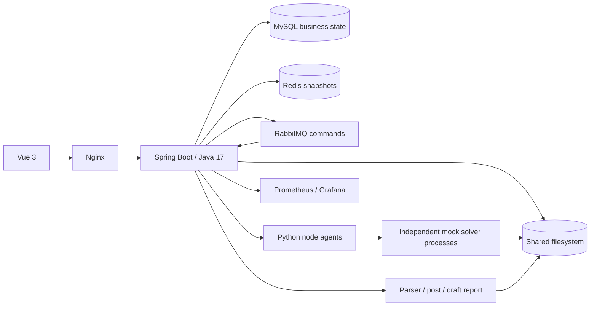

# Architecture

Public CAE control plane. Independent Python agents execute synthetic solvers; commercial CAE algorithms and licenses are outside this repository.

This architecture is implemented and exercised by the public Compose acceptance suite. [Progress](progress.md) records each completed milestone and durable evidence.

MySQL owns Job state, CAS versions, input identities, execution attempts, reservations, Outbox/Inbox, parser and pipeline versions, reports and batch intents. Redis only accelerates permission-checked reads and observations. RabbitMQ transports at-least-once commands with persistent confirms and explicit retry/DLQ handling. Workers preserve execution fingerprints and process identities in SQLite; uncertain remote observations retain reservations until confirmed reconciliation.

Parsing runs in Java through ResultParser strategies. Frozen post/report specifications invoke Python workers for actual synthetic Matplotlib PNGs and python-pptx documents. Atomic immutable file publication and database registration bind all artifacts to the original snapshot, execution, parser, condition and Subcase. Bounded batch feeding and admission transactions constrain active work; SSE emits committed events and the UI refreshes authoritative GET results.

See [state machine](state-machine.md), [domain tables](domain-model.md), [resource admission ADR](adr/ADR-007-durable-resource-admission.md), [reconciliation](monitoring-reconciliation.md), [reports](post-and-reports.md), [monitoring](observability.md) and [enterprise replacement boundaries](real-system-mapping.md).
