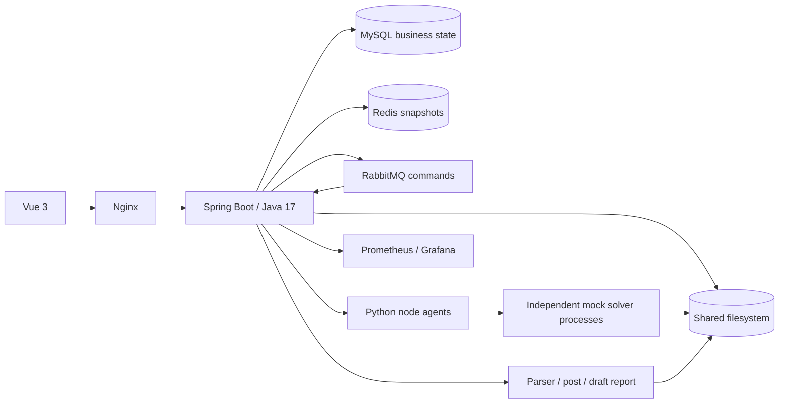

# Architecture

Public CAE control plane. Independent Python agents execute synthetic solvers; commercial CAE algorithms and licenses are outside this repository.

This describes the target design. Implemented and validated milestones are recorded in `progress.md`.
