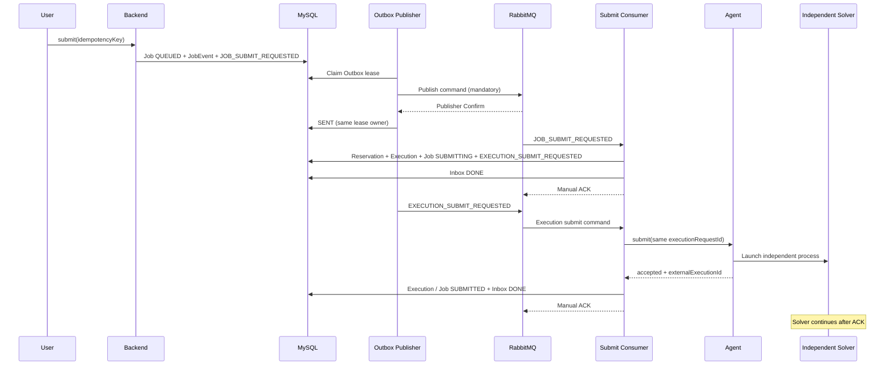

# RabbitMQ、Outbox 与提交幂等

本实现将业务状态、事件日志和待发送消息先存入同一个 MySQL 事务。RabbitMQ 的持久化队列和 Publisher Confirm 承担消息交付，Inbox 和 Agent 的持久化执行键承担重复处理保护。

## 实际队列

| Exchange | Routing key | Queue | Dead-letter queue |
| --- | --- | --- | --- |
| cae.command | job.submit | cae.job.submit | cae.job.submit.dlq |
| cae.command | job.parse | cae.job.parse | cae.job.parse.dlq |
| cae.command | job.postprocess | cae.job.postprocess | cae.job.postprocess.dlq |
| cae.command | job.report | cae.job.report | cae.job.report.dlq |
| cae.event | job.EVENT_TYPE | cae.event.audit | 无 |

`cae.dead` 将阶段失败路由为 `job.<stage>.dead`。以上 exchange、queue、binding 都由 `RabbitTopology` 声明且持久化。Milestone 5 仅安装 submit Consumer；尚未实施的解析、后处理、报告命令会留在对应队列中。事件存档队列保留事件，数据库 JobEvent 仍为查询的权威数据。

## 事务边界与命令



每个 JobEvent 都有事件 exchange 副本。`JOB_SUBMIT_REQUESTED`、`RESULT_PARSE_REQUESTED`、`POST_PROCESS_REQUESTED`、`REPORT_REQUESTED` 另有命令副本。`EXECUTION_ALLOCATED` 另外生成包含 executionId 的 `EXECUTION_SUBMIT_REQUESTED`。副本各自有独立逻辑 eventId。

后台扫描只负责校验、待资源任务分配与取消续办。它不会直接重试 SUBMITTING 的 Agent 提交；远程提交只由实际 RabbitMQ Consumer 发起。成功分配会在事务内形成执行命令，因此后台进程在分配后退出也不会丢失提交。

## 消息格式和两个 ID

```json
{
  "eventId": "evt-logical-uuid",
  "deliveryId": "evt-physical-uuid",
  "eventType": "EXECUTION_SUBMIT_REQUESTED",
  "jobId": 123,
  "jobNo": "CAE-20261011-000123",
  "occurredAt": "2026-10-11T00:00:00Z",
  "payloadVersion": 1,
  "deliveryAttempt": 0,
  "payload": {"executionId": 321}
}
```

`eventId` 是 Inbox 去重的逻辑键。`deliveryId` 是唯一的物理 Outbox 行/AMQP messageId；业务重试生成新的 deliveryId，保留 eventId、executionId 和 executionRequestId。Consumer 验证消息版本、Job 身份和 execution 所属 Job。错误版本或错配命令直接进入 DLQ，不会执行 Solver。

## 数据库记录

`cae_outbox_event.event_id` 保存物理 deliveryId；`logical_event_id` 保存逻辑 eventId。主要状态为 NEW、PUBLISHING、RETRY、SENT、DEAD。`claim_owner`/`claim_until` 支持多 Publisher 和退出恢复。Outbox `retry_count` 统计 broker 发布重试；`delivery_attempt` 表示业务重试次数，两者独立。

`cae_message_inbox` 使用 `(logical_event_id, consumer_name)` 唯一键，submit Consumer 名为 `job-submit-v1`。状态为 NEW、PROCESSING、RETRY、DONE、DEAD。租约保证并发重复消息只有一个处理者；过期租约允许恢复。延迟重投的 Outbox 与 Inbox RETRY 共同提交，之后才 ACK 原消息。

首次 claim 使用 `INSERT ... ON DUPLICATE KEY UPDATE id=id`，直接获取唯一行的排他锁，再读取租约。重复分支不修改已有业务字段；避免多个 `INSERT IGNORE` 持有共享唯一行锁、再同时升级 `FOR UPDATE` 时发生死锁。真实 MySQL 并发测试同时发送 10 个物理投递检查这一边界。

同一执行重试耗尽时，不确定提交会进入 UNKNOWN，并保留 reservation。仅远端确认未接收或已终止才能释放资源；后台对账负责后续恢复。

## 配置

| 配置 | 默认值 | 用途 |
| --- | --- | --- |
| cae.outbox.scan-ms | 500 | Publisher 周期 |
| cae.outbox.batch-size | 20 | 单次有界 claim |
| cae.outbox.confirm-timeout-ms | 3000 | Confirm 等待上限 |
| cae.outbox.max-publish-attempts | 8 | 发布失败上限 |
| cae.mq.listeners-enabled | true | 运行环境安装 submit Consumer |
| cae.mq.submit-concurrency | 2 | 并发接收者 |
| cae.mq.max-delivery-attempts | 4 | 业务接收失败次数上限，含第一次 |
| cae.mq.retry-base-ms | 500 | 业务指数退避基数，上限 30s |

Inbox 处理租约为 45s。RabbitMQ 连接超时显式设置为 3s；Publisher 租约按 batch-size × (confirm-timeout-ms + 3000ms) 加 30s 计算，覆盖连接建立与 Confirm 等待，避免一个批次的等待使后面的消息提前丧失租约。数据库异常的消费者恢复退避为 250ms、500ms、1s、2s、4s、5s 封顶，消息始终先保持 unacked。

普通集成测试关闭后台与 Consumer，使用隔离的 MySQL schema、Rabbit vhost 和 Redis namespace。MQ 测试单独启用 Consumer，通过 `publishIds` 仅发布本测试拥有的 Outbox 行，避免启动旧测试的受控 Agent。

## 实际验证入口

运行 `bash scripts/test-backend.sh` 完成 Java 验证。M5 live smoke 使用 `tests/e2e/messaging_smoke.py` 检查运行中真实 RabbitMQ、MySQL 和 Agent 的 Outbox SENT、Inbox DONE、重复提交唯一执行、接收后超时重试、Solver 完成前 ACK 及定向 DLQ。阶段验证的实际结果保存在 `docs/validation`。

当前 Micrometer 指标包括 `cae_outbox_pending`、`cae_outbox_published_total`、`cae_outbox_publish_retry_total`、`cae_mq_commands_acked_total`、`cae_mq_commands_retry_total`、`cae_mq_commands_dead_total` 和提交接收耗时。待发送 Gauge 在 Publisher 扫描时刷新。
