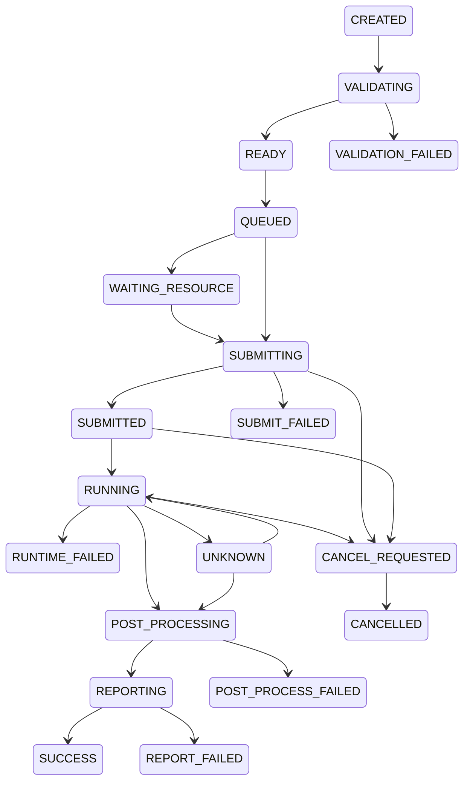

# Job state machine

A Job stores business state in MySQL; an Agent stores the remote execution fact. Solver success alone does not imply Job SUCCESS: parsing, postprocessing and draft reporting must finish.

The Java transition policy is authoritative; this diagram describes the primary path, not every edge. Retries return retryable failed jobs to READY and create a new execution attempt; terminal states do not accept delayed RUNNING events. Repeating the current state is idempotent. Cancellation after an execution exists waits for remote confirmation; UNKNOWN is reconciled without resubmitting.

Persistence checks the observed status and version together. Status updates, business events and (from Milestone 5) Outbox records must commit atomically. See `progress.md` for the tested milestone coverage.
